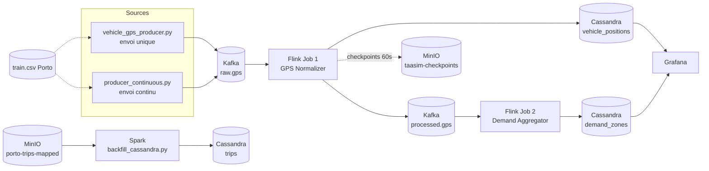

# 🚖 TaaSim : Pipeline de données temps réel pour taxis (Casablanca)

> Plateforme de data engineering qui ingère des positions GPS de taxis en streaming, les nettoie, les anonymise, puis calcule la demande par zone en temps réel.


---

## 📌 Sommaire

1. [Présentation](#-présentation)
2. [Architecture](#-architecture)
3. [Stack technique](#-stack-technique)
4. [Structure du dépôt](#-structure-du-dépôt)
5. [Les jobs en détail](#-les-jobs-en-détail)
6. [Prérequis](#-prérequis)
7. [Démarrage rapide](#-démarrage-rapide)
8. [Test des watermarks (late events)](#-test-des-watermarks-late-events)
9. [Schéma Cassandra](#-schéma-cassandra)
10. [Ports et interfaces](#-ports-et-interfaces)
11. [Exigences non fonctionnelles](#-exigences-non-fonctionnelles)
12. [Limites connues et pistes d'amélioration](#-limites-connues-et-pistes-damélioration)
13. [Auteure](#-auteure)

---

## 🎯 Présentation

**TaaSim** (*Taxi as a Simulation*) simule une flotte de taxis à Casablanca et traite ses flux de données de bout en bout :

- **Ingestion** : des positions GPS sont publiées en continu dans Kafka.
- **Traitement streaming (Flink)** : validation, gestion des événements en retard, mapping par arrondissement, **anonymisation** des coordonnées.
- **Agrégation temps réel** : nombre de véhicules et vitesse moyenne par zone, par fenêtre de 30 secondes.
- **Stockage** : Cassandra pour le serving temps réel, MinIO (S3) pour le data lake et les checkpoints.
- **Batch (Spark)** : backfill de trajets historiques vers Cassandra.
- **Visualisation** : Grafana et un dashboard Power BI.

Le jeu de données source est le dataset public de trajectoires de taxis de **Porto** (`train.csv`). Ses coordonnées sont **projetées linéairement** sur la bounding box de Casablanca pour simuler une flotte locale.

---

## 🏗 Architecture



### Flux de données

| Étape | Source | Traitement | Destination |
|------|--------|-----------|-------------|
| 1 | `train.csv` (Porto) | Projection des coordonnées vers Casablanca | Kafka `raw.gps` |
| 2 | Kafka `raw.gps` | Validation, drop des late events, mapping de zone, anonymisation | Cassandra `vehicle_positions` + Kafka `processed.gps` |
| 3 | Kafka `processed.gps` | Fenêtres de 30 s par zone (vehicle_count, event_count, avg_speed) | Cassandra `demand_zones` |
| 4 | Parquet `porto-trips-mapped` | Enrichissement et mapping vers le schéma `trips` | Cassandra `trips` |

---

## 🧰 Stack technique

| Composant | Technologie | Rôle |
|-----------|-------------|------|
| Messaging | Apache Kafka 7.6.1 (Confluent, mode KRaft, sans ZooKeeper) | Bus d'événements |
| Stream processing | Apache Flink 1.17.2 + PyFlink | Jobs 1 et 2 |
| Batch | Apache Spark 3.5.0 (PySpark) | Backfill |
| Base serving | Apache Cassandra 4.1 | Positions, demande par zone, trajets |
| Data lake | MinIO (compatible S3) | Buckets `raw`, `curated`, `ml`, `checkpoints` |
| Exploration | JupyterLab (`pyspark-notebook`) | Producers et notebooks |
| Visualisation | Grafana 10.4.2, Power BI | Dashboards |
| Orchestration | Docker Compose | Environnement local reproductible |

---

## 📁 Structure du dépôt

```text
taasim-pipeline/
├── docker-compose.yml            # Infrastructure complète (Kafka, MinIO, Cassandra, Flink, Spark, Jupyter, Grafana)
├── flink.Dockerfile              # Image Flink 1.17.2 avec Python (PyFlink) et dépendances
├── jobs/
│   ├── job1_gps_normalizer.py    # Job Flink 1 : validation, zones, anonymisation
│   ├── job2_demand_aggregator.py # Job Flink 2 : agrégation de la demande par zone
│   └── test_late_events.py       # Test des watermarks (événements en retard)
├── notebooks/
│   ├── vehicle_gps_producer.py   # Producer Kafka : envoi unique de 1000 trajets
│   ├── producer_continuous.py    # Producer Kafka : envoi continu (cycles de 50 messages)
│   └── backfill_cassandra.py     # Job Spark : backfill des trajets vers Cassandra
└── README.md
```

> ⚠️ Les données volumineuses (`datasets/train.csv`, `notebooks/porto-trips-mapped/`, `.pbix`, PDF) sont **exclues du dépôt** via `.gitignore`.

---

## ⚙️ Les jobs en détail

### 🟦 Job 1 : GPS Normalizer (`jobs/job1_gps_normalizer.py`)

**Pipeline :** Kafka `raw.gps` → drop des late events → validation → normalisation et anonymisation → Cassandra + Kafka `processed.gps`.

| Étape | Détail |
|-------|--------|
| **Event time** | Extrait du champ `timestamp` (millisecondes) du message |
| **Watermark** | `bounded_out_of_orderness` de **3 minutes** |
| **Drop late events** | Les événements dont le timestamp est inférieur au watermark sont rejetés |
| **Validation** | JSON valide, champs obligatoires (`taxi_id`, `timestamp`, `lat`, `lon`), coordonnées dans la bounding box de Casablanca, vitesse ≤ 150 km/h |
| **Zone mapping** | Affectation à l'un des **16 arrondissements** (zone la plus proche si aucune zone exacte) |
| **Anonymisation** | `lat`/`lon` bruts **remplacés par le centroïde de la zone** : les coordonnées exactes ne sont jamais persistées |
| **Sinks** | Cassandra `vehicle_positions` (**TTL 1 h**) et Kafka `processed.gps` |
| **Checkpointing** | Toutes les 60 s, mode `EXACTLY_ONCE`, vers MinIO |
| **Parallélisme** | 2 |

Bounding box : latitude `33.40 → 33.70`, longitude `-7.80 → -7.45`.

<details>
<summary><b>Les 16 zones de Casablanca</b></summary>

| ID | Zone | Centroïde (lat, lon) |
|----|------|----------------------|
| 1 | Anfa | 33.610, -7.600 |
| 2 | Ain Chock | 33.570, -7.530 |
| 3 | Ain Sebaa | 33.635, -7.500 |
| 4 | Ben M'Sik | 33.555, -7.550 |
| 5 | Bernoussi | 33.630, -7.575 |
| 6 | Hay Hassani | 33.565, -7.640 |
| 7 | Maarif | 33.590, -7.615 |
| 8 | Sidi Belyout | 33.605, -7.585 |
| 9 | Hay Mohammadi | 33.625, -7.660 |
| 10 | Sidi Moumen | 33.575, -7.685 |
| 11 | Ain Diab | 33.525, -7.600 |
| 12 | Bouskoura | 33.650, -7.640 |
| 13 | Oulfa | 33.510, -7.530 |
| 14 | Sbata | 33.585, -7.685 |
| 15 | Sidi Othmane | 33.665, -7.530 |
| 16 | Dar Bouazza | 33.450, -7.740 |

</details>

### 🟩 Job 2 : Demand Aggregator (`jobs/job2_demand_aggregator.py`)

**Pipeline :** Kafka `processed.gps` → `key_by(zone_id)` → agrégation par fenêtre → Cassandra `demand_zones`.

- **Fenêtres** de **30 secondes** (`WINDOW_MS = 30000`), implémentées avec un `KeyedProcessFunction` et un état par clé.
- **Timers event-time** : une fenêtre est émise à `fin de fenêtre + 10 s` (`LATE_MS = 10000`), ce qui tolère un léger retard.
- **Métriques produites par (zone, fenêtre)** : `vehicle_count` (taxis distincts), `event_count` (nombre de messages), `avg_speed`.
- Consumer group : `demand-v7`, parallélisme 1.

### 🟥 Backfill Spark (`notebooks/backfill_cassandra.py`)

Lit les trajets Porto transformés (`porto-trips-mapped`, Parquet), garde un échantillon de **1000 trajets** et les écrit dans Cassandra (`taasim.trips`) via le connecteur Spark-Cassandra. Les champs `rider_id`, `origin_zone`, `dest_zone`, `status` et `fare` sont des **valeurs fixes de test**.

### 🟨 Producers GPS

| Script | Comportement |
|--------|--------------|
| `vehicle_gps_producer.py` | Lit 1000 lignes de `train.csv`, publie **un point GPS par trajet** puis s'arrête |
| `producer_continuous.py` | Boucle infinie : tous les **3 s**, tire 50 trajets au hasard et publie un message chacun (statut aléatoire `available`/`busy`) |

**Projection Porto → Casablanca** (transformation linéaire des coordonnées) :

```text
casa_lon = -7.70 + (lon + 8.73) / 0.23 × 0.15
casa_lat = 33.50 + (lat - 41.10) / 0.15 × 0.10
```

---

## 📋 Prérequis

- [Docker Desktop](https://www.docker.com/products/docker-desktop/) avec **8 Go de RAM** minimum alloués
- [Git](https://git-scm.com/)
- Le dataset **Porto taxi trajectories** (`train.csv`), compétition Kaggle *ECML/PKDD 15: Taxi Trajectory Prediction*

---

## 🚀 Démarrage rapide

### 1. Cloner le dépôt

```bash
git clone https://github.com/sara-alioui/taasim-pipeline.git
cd taasim-pipeline
```

### 2. Ajouter les données (non versionnées)

```bash
mkdir datasets
# Placer train.csv dans ./datasets/train.csv
```

### 3. Lancer l'infrastructure

```bash
docker compose up -d --build
docker compose ps        # vérifier que tous les conteneurs sont "Up"
```

Le premier démarrage construit l'image `taasim-flink-python:1.17.2` et crée automatiquement les buckets MinIO : `taasim-raw`, `taasim-curated`, `taasim-ml`, `taasim-checkpoints`.

### 4. Créer le schéma Cassandra

Attendre que Cassandra soit *healthy* (environ 1 à 2 minutes), puis :

```bash
docker exec -it cassandra cqlsh
```

et exécuter le script de la section [Schéma Cassandra](#-schéma-cassandra).

### 5. Soumettre les jobs Flink

```bash
docker exec -it flink-jobmanager flink run -d -py /opt/flink/jobs/job1_gps_normalizer.py
docker exec -it flink-jobmanager flink run -d -py /opt/flink/jobs/job2_demand_aggregator.py
```

Suivre les jobs dans l'interface Flink : <http://localhost:9091>.

### 6. Produire des données GPS

Depuis JupyterLab (<http://localhost:8888>), ouvrir un terminal et lancer :

```bash
python /home/jovyan/work/producer_continuous.py
```

### 7. Vérifier les résultats

```sql
USE taasim;

SELECT * FROM vehicle_positions WHERE city = 'Casablanca' AND zone_id = 7 LIMIT 10;
SELECT * FROM demand_zones WHERE zone_id = 7 LIMIT 10;
```

### 8. (Optionnel) Backfill Spark

```bash
# Depuis un terminal Jupyter
python /home/jovyan/work/backfill_cassandra.py
```

> Le connecteur Spark-Cassandra doit être disponible dans l'environnement Spark (par exemple via `--packages com.datastax.spark:spark-cassandra-connector_2.12:3.5.0`). Le dossier `porto-trips-mapped` est produit en amont par une transformation Spark des données Porto.

### Arrêter l'environnement

```bash
docker compose down        # conserve les volumes (données)
docker compose down -v     # supprime aussi les volumes
```

---

## 🧪 Test des watermarks (late events)

Le script `jobs/test_late_events.py` valide la gestion des événements en retard. Il envoie trois séquences vers `raw.gps` :

| Séquence | Retard simulé | Résultat attendu |
|----------|---------------|------------------|
| **A** : `TAXI_A_*` | Aucun | ✅ Présents dans Cassandra |
| **B** : `TAXI_B_*` | 2 minutes (< 3 min) | ✅ Présents dans Cassandra |
| **C** : `TAXI_C_*` | 5 minutes (> 3 min) | ❌ **Absents** (rejetés par Job 1) |

**Exécution :** s'assurer que le Job 1 tourne, puis lancer le script depuis Jupyter :

```bash
python /home/jovyan/work/test_late_events.py
```

Le script interroge ensuite Cassandra automatiquement (après 20 s) et affiche `TEST WATERMARK RÉUSSI` si A et B sont présents et C absent.

---

## 🗄 Schéma Cassandra

> Schéma de référence **déduit du code des jobs**. À adapter si votre schéma réel diffère.

```sql
CREATE KEYSPACE IF NOT EXISTS taasim
  WITH replication = {'class': 'SimpleStrategy', 'replication_factor': 1};

USE taasim;

-- Positions anonymisées (Job 1), TTL 3600 s appliqué à l'insertion
CREATE TABLE IF NOT EXISTS vehicle_positions (
  city        text,
  zone_id     int,
  event_time  bigint,
  taxi_id     text,
  lat         double,
  lon         double,
  speed       double,
  status      text,
  PRIMARY KEY ((city, zone_id), event_time)
) WITH CLUSTERING ORDER BY (event_time DESC);

-- Demande par zone et par fenêtre de 30 s (Job 2)
CREATE TABLE IF NOT EXISTS demand_zones (
  zone_id       int,
  window_start  bigint,
  window_end    bigint,
  vehicle_count int,
  event_count   int,
  avg_speed     double,
  PRIMARY KEY (zone_id, window_start)
) WITH CLUSTERING ORDER BY (window_start DESC);

-- Trajets (backfill Spark)
CREATE TABLE IF NOT EXISTS trips (
  city         text,
  date_bucket  text,
  created_at   timestamp,
  trip_id      text,
  rider_id     text,
  taxi_id      text,
  origin_zone  int,
  dest_zone    int,
  status       text,
  fare         double,
  PRIMARY KEY ((city, date_bucket), created_at, trip_id)
);
```

---

## 🌐 Ports et interfaces

| Service | URL / Port | Remarques |
|---------|-----------|-----------|
| Flink UI | <http://localhost:9091> | JobManager (8081 en interne) |
| Spark Master UI | <http://localhost:8082> | Master sur `spark://spark-master:7077` |
| Spark Worker UI | <http://localhost:8083> | |
| Spark Application UI | <http://localhost:4040> | Actif pendant l'exécution d'un job |
| MinIO Console | <http://localhost:9001> | Identifiants de dev : `minioadmin` / `minioadmin` |
| MinIO API (S3) | `localhost:9000` | |
| JupyterLab | <http://localhost:8888> | Sans token (usage local uniquement) |
| Grafana | <http://localhost:3000> | |
| Cassandra (CQL) | `localhost:9042` | |
| Kafka | `kafka:9092` (réseau Docker), `localhost:29092` (depuis l'hôte) | Mode KRaft |

---

## ✅ Exigences non fonctionnelles

| Exigence | Mise en œuvre |
|----------|---------------|
| **Fraîcheur** GPS → Cassandra < 15 s | Pipeline streaming sans micro-batch, écriture directe par Flink |
| **Tolérance aux pannes** | Checkpoints Flink toutes les 60 s vers MinIO (`s3://taasim-checkpoints/`), mode `EXACTLY_ONCE` |
| **Confidentialité** | Coordonnées brutes jamais persistées : remplacées par le centroïde de zone |
| **Qualité des données** | Rejet des JSON malformés, coordonnées hors Casablanca, vitesses aberrantes, événements trop tardifs |
| **Rétention** | Positions conservées 1 h (TTL Cassandra), topics Kafka conservés 168 h |

---

## 🔧 Limites connues et pistes d'amélioration

- 🔐 **Identifiants en clair** dans `docker-compose.yml` (MinIO) et Jupyter sans mot de passe : acceptable en local, à externaliser (`.env`, secrets) avant tout déploiement.
- 📊 **Données de test fixes** dans le backfill (`fare = 15.50`, zones 1 et 5) : à remplacer par un vrai calcul de zones origine/destination.
- 🔁 **Mono-nœud** : un seul broker Kafka, un seul nœud Cassandra (`replication_factor = 1`) : pas de haute disponibilité.
- 📈 **Pistes** : tests automatisés des fonctions (`find_zone`, validation), monitoring Prometheus/Grafana des jobs Flink, CI GitHub Actions, orchestration avec Airflow, stockage du dataset via Git LFS ou MinIO.

---

## 👩‍💻 Auteure

**Sara Alioui**, étudiante en data engineering (dernière année, ENSAH, Maroc)

[](https://github.com/sara-alioui)

---

<sub>Projet réalisé dans un cadre académique. Dataset source : *Taxi Service Trajectory (ECML/PKDD 15)*, Porto, Portugal.</sub>